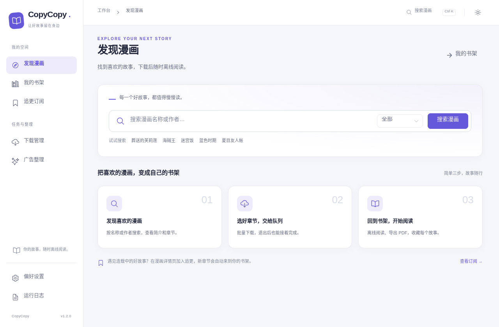
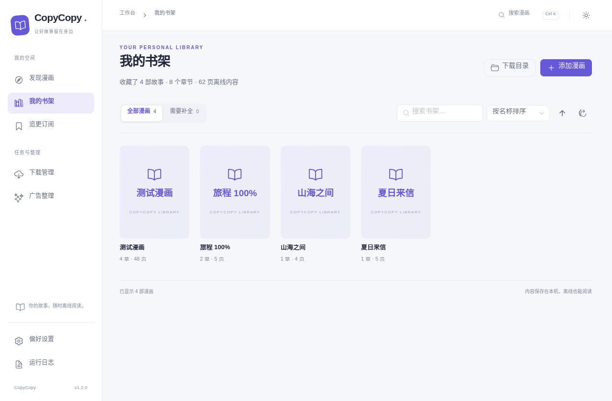
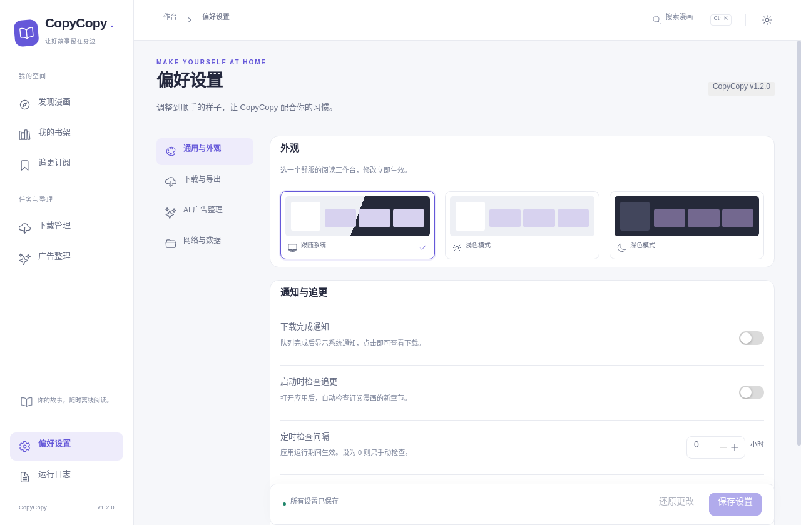
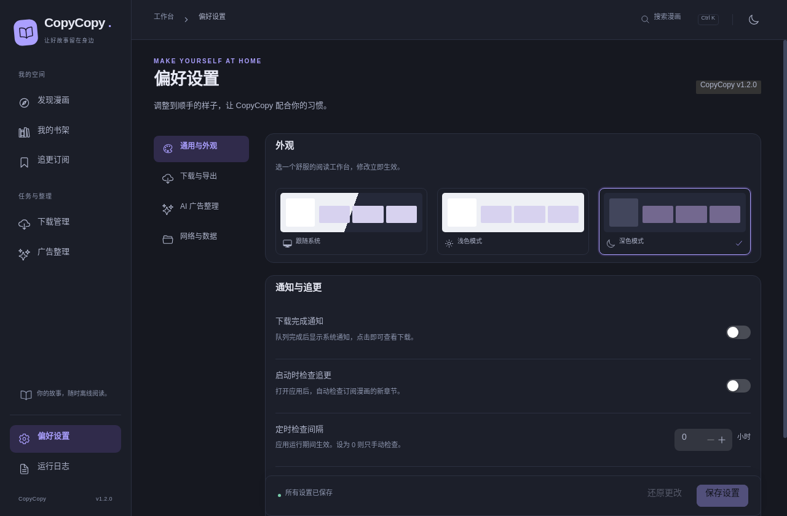

# CopyCopy 1.2 桌面体验整理

## 页面与操作

| 页面 | 常用操作 |
| --- | --- |
| 发现漫画 | 按漫画名、作者搜索；最近搜索；进入详情选择章节 |
| 我的书架 | 浏览封面、筛选漫画、补全缺页、进入阅读器 |
| 追更订阅 | 检查更新、调整单次下载上限、取消追更 |
| 下载管理 | 按进行中／已完成／需重试筛选，查看页数、速度和剩余时间 |
| 广告整理 | 查看各批次结果、重试失败章节、取消尚未开始的检测 |
| 偏好设置 | 通用与外观、下载与导出、AI 广告整理、网络与数据 |

常用操作集中在对应页面。删除、清空等操作留在更多菜单和确认对话框中。运行日志支持文本筛选和只看警告、错误。

## 外观

使用统一的侧边导航、封面卡片、页面标题、空状态和设置行组件。默认跟随系统，也可固定浅色或深色；选择保存在当前用户的本机配置中。阅读器使用独立的深色阅读区域，隐藏工作台导航。

以下截图使用隔离的本地测试数据：






- `Ctrl/Cmd + K`：进入搜索并聚焦输入框。
- 漫画封面、章节选择支持标准键盘焦点和激活。
- 下载页面移除了按 Enter 直接取消任务的全局快捷键。
- 返回发现页时保留上一次搜索结果和已输入的搜索词。
- 书架记住上次打开的章节，支持继续阅读。

## 修复的行为

- AI 检测结束后，失败／取消章节可以重新排队；成功章节不会重复检测。
- 下载数量直接来自任务列表；首次加载、清空记录和实时进度保持一致。较早返回的快照不会覆盖更新的进度。
- 阅读器在上一章／下一章切换时加载对应章节，忽略过时响应。
- Vue Router 已解码的漫画名称不再二次解码，含 `%` 的名称可以正常打开。
- 设置在独立草稿中编辑。保存才更新全局运行配置；离开时可保存或放弃。仅修改 API Key 也会标记为未保存。
- 跨页下载仅请求未缓存的已选章节页。获取章节失败时保留选择，并明确报告错误。
- 关闭代理显式切换到直连，不会重新启用环境变量中的代理。
- 封面读取失败时显示可用的书名占位，区分加载失败、无搜索结果和真正的空书架。

原有 `comic.yaml`、下载目录、PDF、追更和广告归档格式继续兼容。新界面偏好和阅读位置只写到本机存储。

## 验证与构建

```bash
npm ci
npm run typecheck
npm run format:check
npm test
npm run test:ui
npm run build:win
```

无桌面的 Linux 环境需使用 `xvfb-run -a npm test` 和 `xvfb-run -a npm run test:ui`。Windows 直接运行以上命令。

`test:ui` 构建并启动真实 Electron 应用，使用隔离的数据目录、用户配置和本地模拟站点，覆盖搜索、跨页下载、追更、阅读器换章、设置保存／放弃、主题持久化和 900px 窗口布局；不调用外部 AI 服务。截图位于 `.tmp/ui-screenshots/`。

GitHub Actions 在 Linux 和 Windows 执行验证。Windows 任务通过后生成安装包和便携版，放在该次运行的 `CopyCopy-Windows-<commit>` 构建产物中，保留 14 天。此流程不发布 Release。
